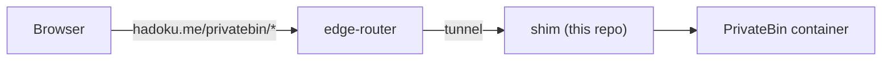

# Contributing

This repo is a thin TypeScript shim plus deployment config; it contains no
PHP and no PrivateBin code. If a change you want belongs in PrivateBin
itself, it belongs upstream, not here — see [the gate](#the-gate) for why
this repo never forks it.



The shim is the only thing standing between the public tunnel and the
container: it checks the edge's seal, applies the create-is-friend+ gate,
and injects the platform theme on the way through.

## Running it locally

```sh
pnpm install
pnpm dev          # tsx watch src/index.ts
pnpm check        # lint + typecheck + test — the same gate as CI
```

The shim proxies to a PrivateBin container it expects at
`PRIVATEBIN_BACKEND_URL` (default `http://127.0.0.1:8090`); point
`docker-compose.yml`'s container at it, or bring one up separately, to see
pastes actually created and read rather than 502s. With no
`EDGE_AUTH_SECRET` set, every request is pinned to the public tier and
creation is impossible — set `PRIVATEBIN_INSECURE_NO_EDGE_AUTH=1` to trust
unverified tier headers for local UI work, and never anywhere the tunnel
host is reachable.

## The gate

`src/gate.ts`'s classification is read directly off PrivateBin 2.0.6's own
router (`lib/Request.php` in the image), not guessed: `POST`, `PUT` and
`DELETE` are all a write; everything else is a read, including the
server-side delete a burn-after-reading paste performs on its own `GET`.
Gating on the method alone, without ever parsing the body, is also what
lets a large attachment stream straight through instead of being buffered
here first.

`src/edge-auth.ts` is why any of this can be trusted: the shim's own public
tunnel hostname is directly reachable, so without verifying
`X-Edge-Auth` against `EDGE_AUTH_SECRET`, anyone could assert
`X-Hadoku-Tier: friend` straight at the tunnel. An unset secret fails
closed — every request degrades to public, which makes the whole service
read-only rather than open.

The create-is-friend+ rule itself is one constant, `CREATE_MIN_TIER =
'friend'` (`src/gate.ts:59`), checked by `mayProceed()` (`src/gate.ts:94`)
and wired into the request pipeline by the gate middleware at
`src/index.ts:114`.

## Architecture map

```
src/index.ts       the shim: health route, edge-provenance middleware, trailing-slash
                    redirect, the create gate, the body-size guard, the proxy itself
src/gate.ts         the create-is-friend+ classification and its refusal bodies
src/edge-auth.ts    verifies X-Edge-Auth; pins to public identity when it can't
src/config.ts       every env-overridable setting, all declared in .devvault.json
src/health.ts       GET /health: the hadoku health contract (status, service, commit)
cfg/conf.php, cfg/php-limits.ini, cfg/nginx-limits.conf
                    mounted read-only into the stock container; this is the whole
                    customization surface — never a modified copy of PrivateBin
web/theme.css       injected into PrivateBin's HTML shell by the shim, not copied in
docker-compose.yml  the pinned, by-digest upstream image; loopback-only port
```

## Tests and gates

`pnpm check` (lint, typecheck, `vitest run`) is the CI gate, run on every
push and PR. `src/__tests__/gate.test.ts` pins the whole read/create split,
including the tier ladder; `src/__tests__/health.test.ts` covers the health
contract.

## How it deploys

A push to `main` runs `.github/workflows/redeploy.yml`, which asks mgmt-api
to sync and rebuild the shim in its own deploy clone and restart the PM2
service fronting it. A push that touches `docker-compose.yml` or `cfg/`
also recreates the PrivateBin container itself afterward, so a new image
digest or config file is live by the time the deploy reports green; a
backend that doesn't come back up fails the deploy. **Never run `docker
compose up` from a dev checkout of this repo.** The live container and
its paste directory live in the deploy clone, and compose derives its
project name from the directory name alone. Running it from `~/repos`
would recreate the production container against an empty local `./data`,
and every paste would read as gone.

## Trivia

The container's own paste directory is deliberately kept outside the
deploy clone entirely, set by the PM2 wrapper from the service's own
declared state directory. A deploy that recreates the container — a new
image digest, a changed `cfg/` file — never touches, let alone resets, a
single stored paste (`ce599ea`).
