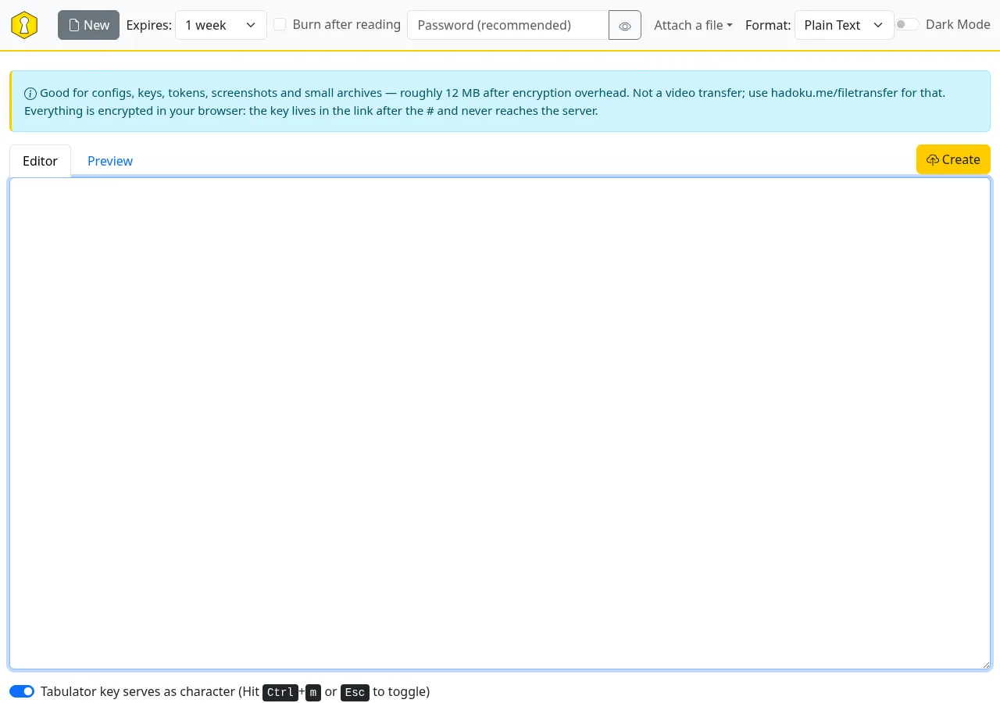

# PrivateBin

This repo holds no PrivateBin code at all — it runs the stock, unforked
[`privatebin/nginx-fpm-alpine`](https://github.com/PrivateBin/PrivateBin)
image, pinned by digest, and everything here is a small Node proxy shim in
front of it. The shim's one job that matters is a split the platform's edge
cannot express on its own: the same URL answers reads for anyone with a
link, but only a signed-in friend account may create a new paste.

- [Features](features.md): what a visitor and a friend-tier creator can
  each do.
- [Contributing](contributing.md): running it locally, the shim's layout,
  how a deploy reaches the live container.
- [History](history.md): the bring-up, and the day a working service looked
  broken from every angle but the right one.
- [Trivia](trivia.md)

## Trivia

PrivateBin itself is never patched here: upgrading it is a `docker pull`
and a digest bump in `docker-compose.yml`'s pinned `image:` line
(`docker-compose.yml:22`), nothing more. The entire point of running it
unforked is that an upstream CVE is a routine pull, not a merge someone has
to notice and perform ([contributing](contributing.md#how-it-deploys)).
